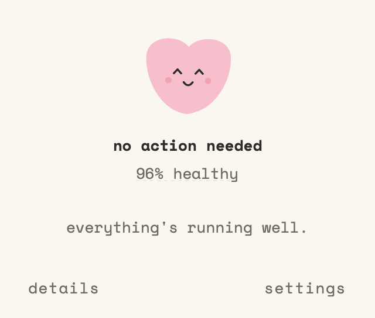
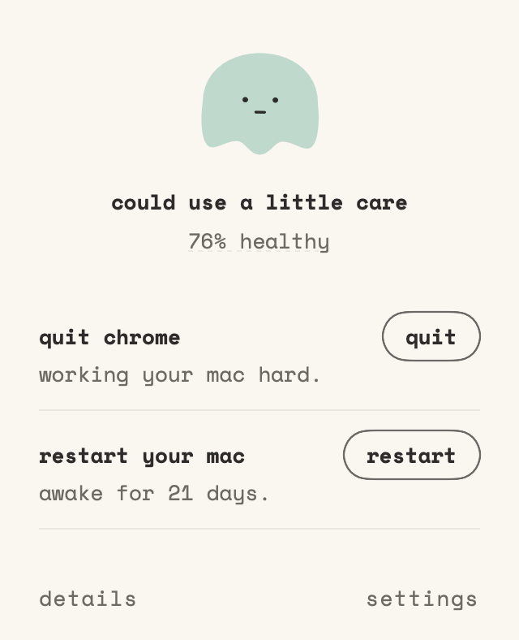

# Pulse

Pulse is a small menu bar app for macOS that shows one health percentage for your Mac and, when something needs attention, up to three things to do about it, each with one click.

<p>
  
  
</p>

## Install

<!-- The repository name below (cheesecake70/pulse-for-macbooks) is the default. Change it here, in scripts/install.sh, scripts/uninstall.sh and the "Build from source" clone URL if the repo is renamed. -->

**The quick way.** Open Terminal and paste:

```bash
curl -fsSL https://raw.githubusercontent.com/cheesecake70/pulse-for-macbooks/main/scripts/install.sh | bash
```

This downloads the latest release, checks the download is intact, checks the app's signature, puts Pulse in your Applications folder and opens it. It may ask for your password if the Applications folder needs it. Piping a script into `bash` runs it unread, so you can read [scripts/install.sh](scripts/install.sh) first.

**The manual way.**

1. Go to the [Releases page](https://github.com/cheesecake70/pulse-for-macbooks/releases/latest) and download `Pulse.zip`.
2. Double-click the zip to unzip it, then drag `Pulse.app` into your Applications folder.
3. Open Pulse. macOS will say it cannot verify the app. This is expected (see Limits below). Click Done.
4. Open **System Settings > Privacy & Security** and scroll down to the **Security** section.
5. Next to the message about Pulse, click **Open Anyway**, then confirm with your password or Touch ID.
6. Open Pulse again. You only need to do this once.

## What it does

- Shows one health score in a panel under the menu bar icon, with a plain state: no action needed, could use care, or needs attention.
- Offers up to three actions in plain words, such as quitting a busy app or restarting your Mac. Each has a one-line reason and a single button.
- Has a Details view with short rows for speed, heat, storage, battery and protection. Numbers live there, one tap down.
- Can start at login and can send one optional notification when your Mac needs attention (at most once every 6 hours).

Pulse only acts when you click. It never quits apps, restarts your Mac or changes settings on its own.

## What it doesn't do

- It does not clean memory, delete files, empty the Trash or touch system processes.
- It does not show temperatures or other sensor readings.
- It does not send anything over the network.
- It does not update itself.

## How the score works

The score starts at 100 and only counts the hardware: how hard your Mac is working (speed), how hot it is (heat), the battery, and a failing disk. Each thing that needs your attention takes points off, and if there is something to do, the score stays out of the healthy range. A Mac that has been on for a long time without a restart loses a few points too.

Storage, FileVault, the firewall, backups and software updates are shown in Details so you can see them, but they never cost points and never create an action.

## Privacy

Everything stays on your Mac. Pulse has no network code, no accounts and no analytics. See [PRIVACY.md](PRIVACY.md) for exactly what it reads and stores.

## Update

Run the install command again. It replaces the old copy with the latest release. To install a specific version, add `PULSE_VERSION=1.0.0` before `bash`:

```bash
curl -fsSL https://raw.githubusercontent.com/cheesecake70/pulse-for-macbooks/main/scripts/install.sh | PULSE_VERSION=1.0.0 bash
```

## Uninstall

```bash
curl -fsSL https://raw.githubusercontent.com/cheesecake70/pulse-for-macbooks/main/scripts/uninstall.sh | bash
```

This quits Pulse, removes its start-at-login entry and deletes `/Applications/Pulse.app`. It keeps your action log and settings. To remove those too, add `-s -- --purge` after `bash`:

```bash
curl -fsSL https://raw.githubusercontent.com/cheesecake70/pulse-for-macbooks/main/scripts/uninstall.sh | bash -s -- --purge
```

## Build from source

You need Xcode or its Command Line Tools (`xcode-select --install`) with Swift 5.10 or newer.

```bash
git clone https://github.com/cheesecake70/pulse-for-macbooks.git
cd pulse
bash scripts/build-app.sh && open Pulse.app
```

To try the app with fake data that changes nothing on your Mac: `swift run Pulse --demo`.

## Tests

```bash
bash scripts/test.sh
```

Use this instead of a bare `swift test`. On Command Line Tools the Testing framework sits outside SwiftPM's search paths, so a bare `swift test` can run zero tests and still report success. The script passes the right flags.

## Requirements

- macOS 14 (Sonoma) or newer.
- Built and run on Apple Silicon. Intel Macs are untested.

## Limits

- Pulse is signed ad hoc, not with a paid Apple Developer ID, and it is not notarised. That is why macOS asks you to approve it the first time if you download it by hand. The signature only shows the app was not changed after it was built; it does not show who built it.
- The checksum the installer verifies comes from the same release as the download. It protects against a damaged download, not against a tampered release. If you want more certainty, build from source.
- There is no auto-update. Run the install command again to update.
- Thresholds are first estimates and may change as the app is tuned on real use.

## Licence

MIT. See [LICENSE](LICENSE).
